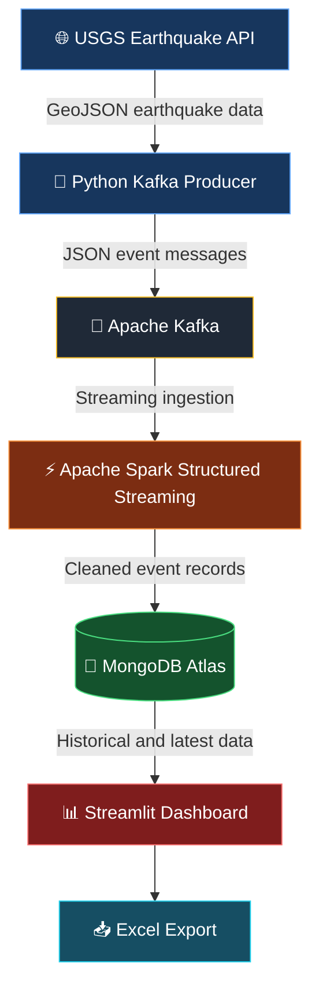

<div align="center">

# 🌍 QuakeScope
### Real-Time Earthquake Monitoring & Analytics System

**Transforming real-world seismic data into meaningful insights through Big Data technologies.**

<br>


<br>


<br>

**[Overview](#-overview) • [Features](#-key-features) • [Architecture](#-system-architecture) • [Installation](#-installation--setup) • [Dashboard](#-dashboard-modules) • [Team](#-development-team)**

---

</div>

## 📖 Overview

**QuakeScope** is a real-time earthquake monitoring and analytics application developed using modern Big Data technologies.

The system retrieves earthquake information from the **United States Geological Survey (USGS) Earthquake API**, transmits event data through **Apache Kafka**, processes it using **Apache Spark Structured Streaming**, and stores the results in **MongoDB Atlas**.

A modern **Streamlit dashboard** visualizes earthquake locations, magnitudes, depths, historical activity, and statistical trends.

QuakeScope demonstrates how streaming data pipelines can transform frequently updated public datasets into useful and accessible insights.

> **Project Goal:** Develop an end-to-end Big Data application that integrates data ingestion, real-time processing, persistent storage, and interactive data visualization.

---

## ✨ Key Features

<table>
<tr>
<td width="50%" valign="top">

### 📡 Live Earthquake Monitoring

- Real earthquake data from USGS
- Automatic dashboard refresh every 15 seconds
- Latest recorded earthquake information
- Magnitude and depth statistics
- Tsunami indicator
- Interactive global earthquake map

</td>
<td width="50%" valign="top">

### 🗃️ Complete Earthquake History

- Persistent storage in MongoDB Atlas
- Historical earthquake records
- Date range filtering
- Magnitude range filtering
- Location search
- Downloadable Excel reports

</td>
</tr>
<tr>
<td width="50%" valign="top">

### 📊 Seismic Data Analytics

- Earthquake magnitude distribution
- Earthquake severity categories
- Earthquake frequency per day
- Magnitude trends over time
- Aggregated earthquake statistics
- Interactive Plotly visualizations

</td>
<td width="50%" valign="top">

### ⚡ Big Data Processing

- Kafka-based event streaming
- Spark Structured Streaming
- JSON data parsing and validation
- Scheduled streaming micro-batches
- MongoDB upsert operations
- Duplicate-event prevention by event ID

</td>
</tr>
</table>

---

## 🏗️ System Architecture

QuakeScope follows a streaming data architecture:



### Pipeline Workflow

| Stage | Technology | Responsibility |
|:---:|---|---|
| **01** | USGS Earthquake API | Provides real earthquake event information |
| **02** | Python Producer | Retrieves API data and publishes JSON events |
| **03** | Apache Kafka | Receives and distributes earthquake messages |
| **04** | Apache Spark | Parses, validates, and processes streaming records |
| **05** | MongoDB Atlas | Stores unique earthquake events persistently |
| **06** | Streamlit | Displays the interactive monitoring dashboard |
| **07** | OpenPyXL | Generates downloadable Excel reports |

---

## 🛠️ Technology Stack

### Backend & Data Engineering

| Technology | Purpose |
|---|---|
| **Python 3.12** | Primary programming language |
| **Apache Kafka** | Real-time event streaming |
| **Apache Spark 4.2.0** | Streaming data processing |
| **PySpark** | Python API for Apache Spark |
| **MongoDB Atlas** | Cloud NoSQL database |
| **USGS GeoJSON API** | Earthquake data source |

### Frontend & Visualization

| Technology | Purpose |
|---|---|
| **Streamlit** | Interactive web application |
| **Plotly** | Geospatial maps and interactive charts |
| **Pandas** | Data manipulation and aggregation |
| **OpenPyXL** | Excel file creation and formatting |

### Development Environment

| Tool | Purpose |
|---|---|
| **Ubuntu Linux** | Development operating system |
| **Conda** | Python environment management |
| **Java 17** | Apache Spark runtime dependency |
| **Git & GitHub** | Version control and collaboration |

---

## 🖥️ Dashboard Modules

### 01 — 🌍 Overview

The Overview page provides an at-a-glance view of global earthquake activity.

**Highlights:**

- Total recorded earthquakes
- Average and maximum magnitude
- Average earthquake depth
- Interactive global seismic map
- Latest earthquake information
- Recent earthquake activity table
- Automatic refresh every 15 seconds

### 02 — 📚 Earthquake History

The History page provides access to earthquake records stored in MongoDB Atlas.

**Available tools:**

- Date range filtering
- Magnitude filtering
- Location searching
- Complete records table
- Excel export of filtered data

### 03 — 📈 Data Analytics

The Analytics page provides statistical visualizations to better understand recorded earthquake activity.

**Visualizations:**

- Magnitude frequency histogram
- Earthquake severity distribution
- Daily earthquake counts
- Magnitude timeline
- Aggregated statistics

### 04 — ℹ️ About

Provides the project overview, system architecture, technologies used, and application objectives.

---

## 📂 Project Structure

```text
BigData-Weather-Monitoring-System/
│
├── app.py                  # Streamlit dashboard
├── producer.py             # USGS API Kafka producer
├── spark_to_mongo.py       # Spark streaming and MongoDB storage
├── requirements.txt        # Python dependencies
├── README.md               # Project documentation
├── .gitignore              # Excluded local files
│
├── .env                    # Local credentials (not committed)
└── checkpoints/            # Spark checkpoints (not committed)
```

> **Security Notice:** The `.env` file contains database credentials and must never be committed to GitHub.

---

## ⚙️ Installation & Setup

### Prerequisites

Ensure the following are installed:

- Ubuntu Linux
- Python 3.12
- Java 17
- Apache Kafka 4.3.1
- Apache Spark 4.2.0
- MongoDB Atlas account
- Git

### 1. Clone the Repository

```bash
git clone https://github.com/piosjoshua/BigData-Weather-Monitoring-System.git

cd BigData-Weather-Monitoring-System
```

### 2. Create a Python Environment

Using Conda:

```bash
conda create -n weather_pipeline python=3.12 -y

conda activate weather_pipeline
```

### 3. Install Python Dependencies

```bash
python -m pip install -r requirements.txt
```

### 4. Configure MongoDB and Kafka

Create a `.env` file in the project root:

```env
MONGODB_URI=your_mongodb_atlas_connection_string
MONGODB_DATABASE=earthquake_db
MONGODB_COLLECTION=earthquake_events

KAFKA_BOOTSTRAP_SERVERS=localhost:9092
KAFKA_TOPIC=earthquake_stream
```

Replace `your_mongodb_atlas_connection_string` with the actual MongoDB Atlas URI.

**Never upload your `.env` file to GitHub.**

### 5. Start Apache Kafka

For the Kafka 4.3.1 KRaft installation used during development:

```bash
cd ~/kafka_2.13-4.3.1

bin/kafka-server-start.sh config/server.properties
```

If your Kafka installation uses a different KRaft configuration file, use the corresponding server configuration.

Kafka storage must already be initialized before starting the broker.

Create the Kafka topic in another terminal:

```bash
cd ~/kafka_2.13-4.3.1

bin/kafka-topics.sh \
  --bootstrap-server localhost:9092 \
  --create \
  --if-not-exists \
  --topic earthquake_stream \
  --partitions 1 \
  --replication-factor 1
```

### 6. Start the Kafka Producer

Open a terminal:

```bash
cd ~/Desktop/BigData-Weather-Monitoring-System

conda activate weather_pipeline

python producer.py
```

The producer retrieves real USGS earthquake records and sends event messages to Kafka.

### 7. Start Apache Spark Streaming

Open another terminal:

```bash
cd ~/Desktop/BigData-Weather-Monitoring-System

conda activate weather_pipeline

export SPARK_HOME=/home/jbbpios/spark

export PYSPARK_PYTHON=/home/jbbpios/miniconda3/envs/weather_pipeline/bin/python

export PYSPARK_DRIVER_PYTHON=$PYSPARK_PYTHON

~/spark/bin/spark-submit \
  --packages org.apache.spark:spark-sql-kafka-0-10_2.13:4.2.0 \
  spark_to_mongo.py
```

> The paths above reflect the Ubuntu development machine. Adjust them according to your own Spark installation and Conda environment.

### 8. Launch the Streamlit Dashboard

Open another terminal:

```bash
cd ~/Desktop/BigData-Weather-Monitoring-System

conda activate weather_pipeline

streamlit run app.py
```

Open the dashboard in a browser:

**http://localhost:8501**

---

## 🗄️ Database Structure

**Database:** `earthquake_db`

**Collection:** `earthquake_events`

Example earthquake document:

```json
{
  "event_id": "example-earthquake-id",
  "timestamp": "2026-11-05T12:00:00Z",
  "magnitude": 4.5,
  "place": "Example seismic region",
  "latitude": 35.5,
  "longitude": 139.5,
  "depth_km": 12.3,
  "tsunami": 0,
  "source": "USGS"
}
```

*The document above is an illustrative example, not an actual USGS earthquake record.*

MongoDB uses a unique index on `event_id` to prevent duplicate earthquake documents.

---

## 🔄 Real-Time Data Processing

QuakeScope follows this update cycle:

| Component | Update Behavior |
|---|---|
| USGS Producer | Polls the earthquake API approximately every 60 seconds |
| Apache Kafka | Receives earthquake event messages |
| Apache Spark | Processes streaming micro-batches every 15 seconds |
| MongoDB Atlas | Stores earthquake events using upsert operations |
| Streamlit | Refreshes the Overview page every 15 seconds |

> **Important:** A 15-second dashboard refresh does not mean a new earthquake occurs every 15 seconds. The dashboard displays the latest earthquake records available in MongoDB.

---

## 🧪 Testing & Validation

The following components have been verified during development:

| Component | Validation |
|---|---|
| USGS API | Retrieved real earthquake event data |
| Kafka Producer | Published earthquake messages successfully |
| Kafka Topic | Received and displayed event messages |
| Apache Spark | Started the Structured Streaming query |
| MongoDB Atlas | Inserted and updated earthquake records |
| Streamlit | Loaded earthquake data from MongoDB |

### Sample Spark Processing Output

```text
Spark streaming started successfully!

Processing Spark batch: 0

total_records:       199
average_magnitude:   1.6928
highest_magnitude:   5.1
lowest_magnitude:   -0.38

Batch 0: Processed 199 records.

Total unique earthquake events in MongoDB: 194
```

The difference between processed records and unique stored events is consistent with repeated earthquake event identifiers being updated instead of inserted again.

---

## 🔐 Security & Data Integrity

The application follows these practices:

- Database credentials are stored locally in `.env`.
- The `.env` file is excluded from Git.
- Spark checkpoint files are excluded from version control.
- Earthquake data is validated before storage.
- A unique index on `event_id` prevents duplicate earthquake documents.
- MongoDB preserves stored records independently of the Streamlit application.

---

## 📚 Data Source & References

Earthquake information is provided by the **United States Geological Survey (USGS)**.

- [USGS Earthquake Hazards Program](https://earthquake.usgs.gov/)
- [USGS GeoJSON Summary Feeds](https://earthquake.usgs.gov/earthquakes/feed/v1.0/geojson.php)
- [Apache Kafka Documentation](https://kafka.apache.org/documentation/)
- [Apache Spark Documentation](https://spark.apache.org/docs/latest/)
- [MongoDB Documentation](https://www.mongodb.com/docs/)
- [Streamlit Documentation](https://docs.streamlit.io/)

---

## 👥 Development Team

<table>
<tr>
<th align="center">Team Member</th>
<th align="center">Role</th>
<th align="center">Responsibilities</th>
</tr>

<tr>
<td align="center">

**Nadine A. Malabanan**

</td>
<td align="center">

**Backend Developer**

</td>
<td>

- USGS API integration
- Apache Kafka configuration
- Kafka producer development
- Apache Spark Structured Streaming
- MongoDB Atlas integration
- Data ingestion and processing

</td>
</tr>

<tr>
<td align="center">

**Joshua Paul B. Pios**

</td>
<td align="center">

**Frontend Developer**

</td>
<td>

- Streamlit dashboard development
- User interface and user experience design
- Interactive earthquake maps
- Data visualization and analytics
- Historical data browsing and filtering
- Excel export implementation

</td>
</tr>
</table>

### 🤝 Project Collaboration

**Nadine A. Malabanan** and **Joshua Paul B. Pios** collaboratively developed QuakeScope as a Big Data Application project.

Both team members contributed to integration, testing, troubleshooting, and documentation to ensure that the backend pipeline and frontend dashboard work together as a complete system.

---

## 🎓 Academic Purpose

QuakeScope was created as a **Big Data Application project** to demonstrate the integration of:

1. Real-world API data ingestion
2. Streaming data transmission
3. Big Data processing
4. NoSQL database storage
5. Interactive dashboard development
6. Historical data analysis and reporting

The project demonstrates an end-to-end data engineering architecture using a real-world public dataset.

---

## ⚠️ Disclaimer

QuakeScope is intended for **educational and analytical purposes only**.

It does not predict earthquakes, issue official earthquake warnings, or replace information from authorized disaster monitoring agencies.

For official earthquake information, visit the [USGS Earthquake Hazards Program](https://earthquake.usgs.gov/).

---

<div align="center">

### 🌍 QuakeScope
**Real-Time Data. Meaningful Insights.**

Developed by **Nadine A. Malabanan** & **Joshua Paul B. Pios**

Built with Python • Apache Kafka • Apache Spark • MongoDB Atlas • Streamlit

<br>

⭐ **If you find this project useful, consider starring the repository!**

</div>
